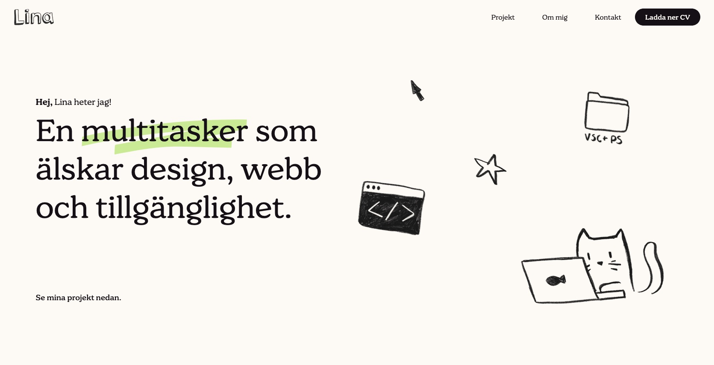
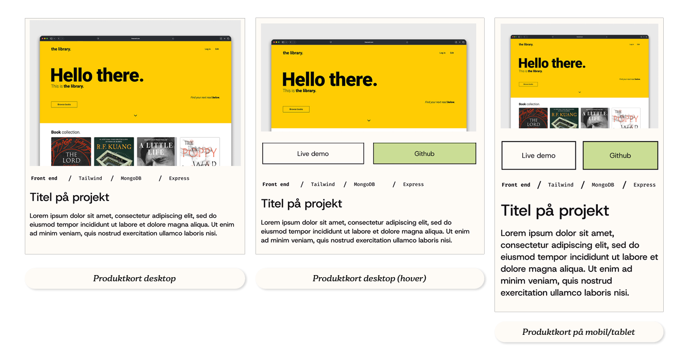
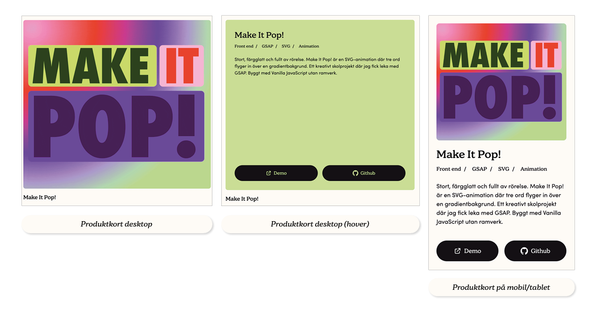
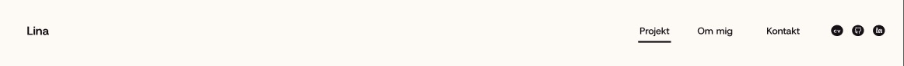
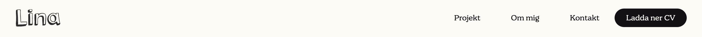
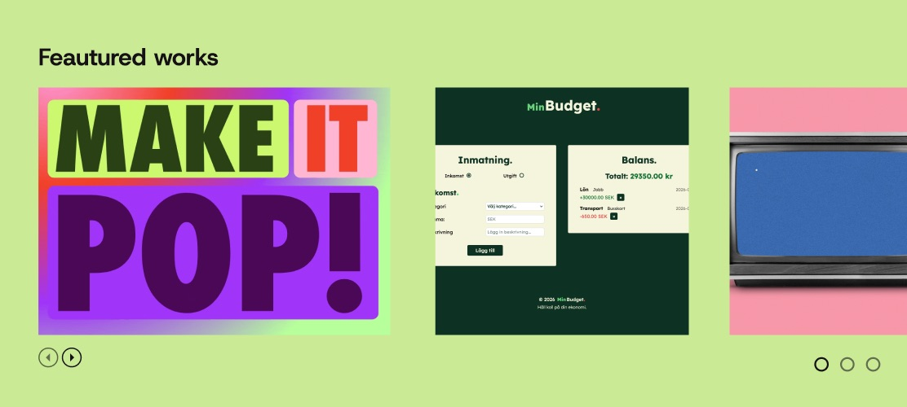

# Portfolio 2.0


[**🔗 Demo**](https://www.linasvard.vercel.app) /
[**Figma**](https://www.figma.com/design/cURvS7YT9FmF4VKFyR1IrQ/Portfolio?node-id=0-1&t=MWnSAvdh3zQaKgUu-1) 

## Om projektet


*Det här är en portfolio byggd som en React SPA* i syfte för LIA-sök och som ett sätt att visa projekt för framtida arbetsgivare. Den innehåller en Hero, Footer och Navbar med länkar till sektionerna: **Projekt**, **Om mig** och **Kontakt**. Sektionen **Projekt** har även en filtrering där du kan filtrera projekt i olika kategorier, där du kan välja flera samtidigt och längre ner har du ett kontaktformulär med validering kopplat till *Formspree*.

Denna portfolio ger mig också möjligheten att visa de kunskaper jag har inom grafisk design och frontend utveckling. Det har jag försökt visa i den visuella delen med hjälp av illustrationer, ett lekfullt typsnitt och animeringar. Det ska inte bara vara en stel portfolio som visar projekt, den ska även spegla mig. 

Portfolion är byggd som en inlämningsuppgift men kommer precis som jag, att utvecklas med tiden.

## Kör projektet lokalt

**1. Klona repot**

```bash
git clone https://github.com/linasvard/portfolio-ver.git
```

**2. Gå in i projektmappen**

```bash
cd portfolio-ver/portfolio
```

**3. Installera dependencies**

```bash
npm install
```

**4. Starta utvecklingsservern**

```bash
npm run dev
```

**5. Öppna `http://localhost:5173/` i webbläsaren**


## Ändringar mot Figma-skissen

Som med vilket annat projekt så dyker det upp hinder eller problem som man måste ta sig igenom och hitta alternativa lösningar till. Antingen så handlar det om att kompromissa eller så får man helt enkelt stryka och tänka om. Här nedan listar jag de ändrar jag gjort på grund av logik eller design.

### Har blivit utbytt helt 

#### Projektkortslayout


*Före* ⬆️


*Efter* ⬆️

**Här hade jag som plan** att använda mig av hover på desktop för att få knapparna att synas och vid mobilläge ha dem synliga under bilden. Detta hade jag en större del av tiden medan jag jobbade på projektet. Men ju mer jag jobbade med det och ju närmare jag kom ett färdigt projekt började det skava rent designmässigt. Det kändes för rörigt med de stora bilderna tillsammans med taggarna och texten. Raderna sträckte sig för långt och blev allt svårare att läsa. 

Jag bestämde mig därför att ta bort all text under bilden och ersätta den med enbart en titel. Taggar, beskrivning och länkar tillsammans med rubrik flyttades till en overlay som aktiveras vid hover i desktop-läge medan de flyttas ut och syns under bilden i tablet- och mobilläge.

### Det jag modifierat

#### Typsnitt
I min skiss i Figma valde jag att använda en sans seriff som heter *Host Grotesk* som funkar väldigt bra med text i webben. Som komplement hade jag ett kodliknande typsnitt som heter *Fira Code* som skulle agera som en stand in för att bryta mot den enkla Host Grotesk. 

När jag började koda valde jag istället att använda ett serif-liknande typsnitt vid namn *Jovie* och ett geometriskt sans-serif typsnitt vid namn *Sofia Pro*. Jovie fick bli mitt primära typsnitt för att leka på den lekfullheten jag skrev om tidigare, och för längre texter och som accent-typsnitt fick Sofia Pro hoppa in.

#### Navbarelement




I min skiss i Figma (överst) la jag till länkar och ikoner för mina sociala kanaler så som GitHub och LinkedIn tillsammans med en CV-länk. I stället behöll jag CV-länken och gjorde den till en knapp och flyttade ner mina länkar till kontakt. Detta för att göra det renare i navbaren.

### Som har uteblivit

#### Carousel



I min skiss kan man se en carousel ovanför mina projekt. Denna var tillför att lyfta fram mina främsta projekt, dem jag är stoltast över. Denna la jag till som ett tillägg utöver kravspecifikationen i mån av tid. I slutet fanns det heller ingen tid till att göra den, men kommer att läggas till i framtiden. 


## Reflektion 

### Komponentarkitektur

### State

### Vad jag skulle göra annorlunda

### AI-verktyg